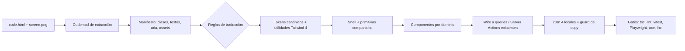

# Plan de migración del frontend — trino. beauty Neo-Pop

> **Fecha:** 2026-11-25 (revisión del inventario desktop y orden de port aprobado; rescan 2026-11-24; primera versión 2026-11-23) · **Autor:** arquitectura (agente) · **Motivo:** migrar la presentación al lenguaje Neo-Pop de las pantallas Stitch sin tocar stack, datos, pagos ni i18n
> **Búsqueda:** keywords: `trino, stitch, neo-pop, migracion-frontend, port-html, tokens, pantallas-faltantes, wcag-aa` · clasificación: `plans` · estado: `borrador`
> **Resumen:** plan canónico para portar las 59 pantallas vigentes del export al stack Next 16 / Tailwind 4 del repo. Clasifica cada pantalla como portar, repeinar, rechazar o diferir; define el pipeline HTML→componentes, la lista de pantallas que faltan y los gates por fase.
> **Parte de:** [[INDICE-SISTEMA]] · Relacionados: [[PRD-trino-minimo]], [[manual-marca]], [[DESIGN]], [[trino-tokens]]

---

## 1. Objetivo y límites

**Objetivo:** reemplazar la presentación actual por el sistema visual Neo-Pop de las pantallas Stitch, apoyándonos en el catálogo, el carrito, la wishlist y los pagos **ya existentes**.

**Principio rector:** es un cambio de *presentación*, no de *comportamiento*. Si una pantalla Stitch pide una regla de negocio nueva (stock, cupones, QR, RMA), se documenta y se difiere; no se inventa una Server Action ni una tabla en el medio del port.

**Entra:**
- Shell visual, tokens, tipografías, iconografía, microinteracciones y estados de las pantallas.
- Home, PLP, PDP, bolsa, checkout, confirmación, favoritos, cuenta, auth, test de tono y 404.
- Externalización de copy a los 4 locales, con voseo en es-AR.
- Accesibilidad AA y verificación visual contra los `screen.png`.

**No entra:**
- Cambios en RLS/RBAC, webhooks (MercadoPago/PayPal/Stripe), rate limiting, Turnstile ni lógica de precios.
- Cambios en migraciones SQL ya aprobadas (la migración `0028` de atributos beauty se commitea *antes* y por separado).
- Claims de fabricación propia, sostenibilidad no verificada, distribución exclusiva, precisión de tono, MUA humana ni facturación corporativa.
- Publicación de fotos `googleusercontent.com` sin cerrar el tema de licencias.

---

## 2. Precedencia de fuentes

Cuando dos fuentes chocan, gana la de arriba.

| # | Fuente | Rol |
|---|---|---|
| 1 | `manual_t_cnico_maestro_definitivo_trino._beauty.txt` | Reglas de negocio, catálogo oficial de pantallas, guardrails, WCAG. **Definitivo.** |
| 2 | `docs/brand/` (`manual-marca.md`, `trino-tokens.css`, `trino-tokens.json`, `checklist-aprobacion.md`, `assets/`) | Identidad visual canónica. |
| 3 | `code.html` + `screen.png` de Stitch | Referencia de composición, jerarquía y microinteracción. |
| 4 | `manual_t_cnico_y_mapa_de_flujos_trino._beauty_actualizado.md` | Apoyo de flujos; no define tokens. |
| 5 | `trino_\DESIGN.md`, `solar_pop_beauty\DESIGN.md`, `trina._beauty\DESIGN.md` | **No canónicos.** Traen `#fef7ff`, Rubik, Plus Jakarta Sans, blur y radio 0. Solo se consultan si el manual y `docs/brand/` callan. Desde el 2026-11-24 viven en `3.ARCHIVOS/`. |

**Rutas del export después del reorden (2026-11-24):** `1.MOBILE/` · `2.DESKTOP/` · `3.ARCHIVOS/` (manual, `DESIGN.md`, referencias y SVGs) · `4.ADMIN/`. El manual definitivo sigue siendo la fuente 1 aunque esté en `3.ARCHIVOS/`.

**Conflicto resuelto de entrada:** las pantallas `*_mua_*` y `modal_test_virtual_de_tono_desktop_paso_2_calibraci_n_*` se rechazan aunque sean visualmente neo-pop: el guardrail 4 prohíbe turnos con humanas y diagnósticos de precisión. El ticker `"100% ORIGINALES DIRECTO"` de `inicio_trina._beauty_2` se quita del copy: choca con el guardrail 2.

**Decisión del 2026-11-24 (tipografía):** el owner aceptó explícitamente la discordancia con `docs/brand/` y pidió usar la pila del HTML de referencia: **Fredoka** en títulos (el propio `code.html` lo aplica inline a los `h1/h2/h3`), **Rubik** en nav, ticker, labels y botones, y **Plus Jakarta Sans** en cuerpo. Las filas de este plan que marcan Rubik/Plus Jakarta como "legacy a repeinar" quedan vigentes como clasificación histórica del audit, pero **no se aplican a la tipografía**. El guard de estilo solo bloquea Geist, icon fonts y hex legacy; no bloquea estas tres fuentes.

**Contraste canónico (manual §6 y tokens canónicos):**
- Ink `#17141B` sobre Cream `#FFF8E8`, Pink `#FF75AE`, Lemon `#FFD84A`, Orange `#FF5A36`, Aqua `#21BFA6` y Lilac `#A98AF5`.
- Cream o blanco **solo** sobre Ink o Cobalt `#3155F5`. Prohibido claro sobre Lemon/Orange/Pink.
- Foco `3px solid #3155F5` con offset 2px; targets táctiles de 44px; `aria-label` descriptivo en cada swatch.

---

## 3. Estado del entregable

Ruta: `E:\Archivos Usuario\Descargas\trino\sticht\stitch_tienda_virtual_de_maquillaje`

| Métrica | Valor (2026-11-24) | Valor (2026-11-23) | Evidencia |
|---|---:|---:|---|
| Pantallas con `code.html` | **59** (2026-11-25), 58 (2026-11-24) | 63 | inventario canónico + alta de #67 |
| — en `1.MOBILE` / `2.DESKTOP` / `4.ADMIN` | 23 / **22** / 14 | — | `2.DESKTOP` sumó `club tirno desktop` |
| Capturas `screen.png` | **65** (59 de pantalla + 6 referencias JPG en `3.ARCHIVOS`) | 70 | inventario del ZIP + #67 |
| Variantes de `DESIGN.md` | 3 | 3 | todas en `3.ARCHIVOS/` |
| Referencias HTTPS en `src` | **193** | 204 | regex sobre los 58 HTML |
| Referencias `googleusercontent.com` | **135 `src` en 36 pantallas** | 141 en 42 | regex sobre los 58 HTML |
| Imágenes locales en `public/` | 0 (solo 5 SVGs de Next) | 0 | `Get-ChildItem public` |

**Diff del rescan:** 3 altas (`carrito vacio mobile`, `trino._beauty_home_desktop_neo_pop_oficial`, `trino._beauty_ficha_de_producto_desktop_neo_pop_oficial`) y 8 bajas (home y PDP mobile, PDP `trina_`, bolsa vacía mobile, modal paso 1 con foto, 2 modales MUA desktop y una variante desktop del paso 3 del test). El inventario quedó en `E:\temp\opencode\stitch-inventory-2026-11-24.tsv`.

**Criterio de clasificación aplicado a los 58 HTML actuales:**

| Marca | Señal detectada | Cantidad (antes) |
|---|---|---:|
| **N — Neo-Pop** | Fredoka o DM Sans + hex canónicos + sombras duras `Npx Npx 0 #17141B` + sin blur | 12 (15) |
| **L — Legacy** | Rubik/Plus Jakarta + `#fef7ff`/`#1d1a21`/`#49464b`/`#625e52`, `bg-surface`, `backdrop-blur` | 29 (30) |
| **M — Mezcla** | Ambos sistemas: se rescata estructura y se repeina | 18 (17) |

Por grupo: mobile 9 N / 11 L / 3 M · desktop 2 N / 5 L / **15 M** (suma #67) · admin 1 N / 13 L / 0 M.

**Shells declarados en el HTML:** `mobile_tab`, `mobile_stack`, `mobile_blank`, `web_standard`, `web_dashboard`, `web_blank`.

> Las capturas no pudieron inspeccionarse visualmente desde el agente; la clasificación es **evidencia del HTML**, reproducible con el script de la sección 11.

---

## 4. Clasificación de las 58 pantallas vigentes (66 IDs históricos)

Leyenda de decisión: **PORTAR** = copiar la composición con tokens canónicos **y reescribir el copy** · **REPEINAR** = conservar estructura, reemplazar estilo y copy · **RECHAZAR** = no se usa · **DIFERIR** = Fase 4 · **REFERENCIA** = guía, no se implementa tal cual.

**Convención de IDs (rescan 2026-11-24):** los IDs del 1 al 63 se conservan del audit original para no romper la trazabilidad; las pantallas que el owner eliminó como obsoletas quedan marcadas **ELIMINADA** en lugar de borrarse. Las 3 pantallas nuevas son #64, #65 y #66. Los títulos de sección mantienen los conteos originales.

| Movimiento | Pantallas |
|---|---|
| **Altas** | #64 `carrito vacio mobile` (N, `mobile_tab`) · #65 `trino._beauty_home_desktop_neo_pop_oficial` (M, `web_standard`) · #66 `trino._beauty_ficha_de_producto_desktop_neo_pop_oficial` (M, `web_standard`) |
| **Bajas** | #1 home mobile · #5 PLP filtrada vieja · #9 y #10 PDP mobile · #12 bolsa vacía mobile · #23 paso 3 desktop alternativo · #30 modal paso 1 con foto · #32 y #33 modales MUA desktop |

**Impacto de las bajas:** se fueron las únicas pantallas **home mobile** y **PDP mobile**. El carrito vacío tiene reemplazo (#64), pero home y PDP mobile vuelven a ser P0 (§6). Las bajas de #23, #30, #32 y #33 no duelen: ya estaban rechazadas o convertidas.

**Corrección aplicada el 2026-11-23 (revisión de pares):** el `shell-type` declarado en el HTML manda por encima del nombre de carpeta. Varias pantallas que parecían duplicados son en realidad **el par desktop/mobile de un mismo flujo** (especialmente el paso 3 del test de tono). A la inversa, los pares con el mismo shell son variantes de *estado*, y varios de ellos se rechazan por copy prohibido, no por viejo. Además, casi todas las pantallas neo-pop llevan claims prohibidos en texto visible (`100% ORIGINALES DIRECTO`, `match garantizado`, `MUA`, `98%`, `refillable`), así que **NE** no implica "lista para publicar": siempre pasa por el guard de §5.1.

### 4.1 Descubrimiento, catálogo y producto (11)

| # | Carpeta (`code.html`) | Tipo | Shell | Destino | Decisión |
|---|---|---|---|---|---|
| 1 | `inicio_trina._beauty_2` | N | ~~mobile_tab~~ | — | **ELIMINADA 2026-11-24** (obsoleta). Reemplazo desktop: #65; falta home mobile Neo-Pop |
| 2 | `explorar_cat_logo_trina_` | N | mobile_tab | `[locale]/tienda/page.tsx` | PORTAR; quitar `100% ORIGINALES MULTIMARCA` |
| 3 | `trino._beauty_cat_logo_filtro_de_marcas_mobile_2` | N | mobile_tab | chips de marca en PLP | PORTAR |
| 4 | `cat_logo_filtrado_tono_03_warm_honey_trino._beauty_mobile_2` | N | mobile_tab | PLP prefiltrada por tono | PORTAR; quitar `MATCH MUA CERTIFICADO`, `Diagnóstico validado por Sol MUA`, `98%` |
| 5 | `cat_logo_filtrado_tono_03_warm_honey_trino._beauty_mobile_3` | L | ~~mobile_tab~~ | — | **ELIMINADA 2026-11-24** (era variante de estado de #4) |
| 6 | `trino._beauty_marcas_oficiales_curadur_a_desktop_neo_pop` | M | web_standard | `[locale]/marcas` | **REPEINADA 2026-11-25**: marcas y conteos desde `products.brand`, sin SKUs ni claims de stock/precio |
| 7 | `trino._beauty_b_squeda_sin_resultados_desktop_neo_pop` | N | web_standard | zero-state PLP | **PORTADA 2026-11-25**: zero-state de `/tienda?q`, sugerencias y recomendaciones desde `products`; sin MUA, stock, descuentos ni WhatsApp inventado |
| 8 | `trino._beauty_error_404_p_gina_no_encontrada_desktop` | N | web_standard | `[locale]/not-found.tsx` | **PORTADA 2026-11-25**: copia reescrita, tarjetas con datos reales y sin claims |
| 9 | `detalle_de_producto_trino._beauty_mobile` | N | ~~mobile_stack~~ | — | **ELIMINADA 2026-11-24** (obsoleta). Reemplazo desktop: #66; falta PDP mobile Neo-Pop |
| 10 | `detalle_de_producto_trina_` | N | ~~mobile_stack~~ | — | **ELIMINADA 2026-11-24** (era referencia, mismo shell que #9) |
| 11 | `trino._beauty_ficha_de_producto_estado_agotado_alerta_de_restock_desktop` | M | web_standard | estado agotado PDP | REPEINAR |

### 4.2 Bolsa, checkout y confirmación (7)

| # | Carpeta | Tipo | Shell | Destino | Decisión |
|---|---|---|---|---|---|
| 12 | `bolsa_vac_a_trino._beauty_mobile` | N | ~~mobile_tab~~ | — | **ELIMINADA 2026-11-24**; reemplazada por #64 `carrito vacio mobile` |
| 13 | `trino._beauty_carrito_drawer_lateral_desktop` | M | web_standard | drawer global | **PORTADA 2026-11-25**: drawer global desde el header, ítems y recomendaciones desde `products`/`product_variants` (solo lectura); sin envío gratis, cuotas, promo, stock ni mutaciones |
| 14 | `trino._beauty_carrito_drawer_con_puntos_glow_canjeados_mobile` | L | mobile_blank | drawer + toggle Glow | REPEINAR |
| 15 | `trino._beauty_checkout_paso_3_selecci_n_de_m_todo_de_pago_desktop_neo_pop` | M | web_standard | `/checkout/pago` | **PORTADA 2026-11-25**: shell compartido con #16 (stepper + grid 7/5), medios de pago y resumen desde `cart_items`/`products` (solo lectura); sin cuotas, descuentos, envío gratis, stock, reserva ni afirmaciones de pago; CTA deshabilitado hasta conectar la pasarela |
| 16 | `trino._beauty_checkout_pago_rechazado_desktop_neo_pop_oficial` | M | web_standard | `/checkout/rechazado` | **PORTADA 2026-11-25**: shell compartido con #15 en estado `rejected` (stepper en atención), acciones para volver al pago o al catálogo; sin reembolsos, cuotas ni promesas de pago |
| 17 | `trino._beauty_pago_por_transferencia_mobile_cuenta_particular_whatsapp_mail` | L | mobile_stack | `/checkout/transferencia` | REPEINAR + quitar CUIT societario |
| 18 | `trino._beauty_confirmaci_n_de_compra_mobile` | L | mobile_stack | `/checkout/confirmacion` | REPEINAR |

**Exports recibidos 2026-11-25 (reclasificación):** el owner envió tres frames desktop nuevos. Los tres usan hex canónicos y son regeneraciones Neo-Pop, pero todos traen copy prohibido (cuotas, envío gratis, stock, reserva, SSL/AFIP/WhatsApp/CUIT, 100% original). El paso 3 (`checkout_paso_3_..._neo_pop_oficial`) confirma #15 y no requiere trabajo nuevo. El paso 1 y el paso 2 se portan como presentación pura con copy reescrito:

| # | Carpeta | Tipo | Shell | Destino | Decisión |
|---|---|---|---|---|---|
| 15a | `checkout_paso_1_contacto_y_direcci_n_desktop` | M | web_standard | `/checkout/contacto` | **PORTADA 2026-11-25**: datos de contacto, destinatario y dirección; campos deshabilitados y CTA inactivo hasta conectar la pasarela; sin AFIP, WhatsApp, CUIT ni stock |
| 15b | `checkout_paso_2_selecci_n_de_env_o_desktop` | M | web_standard | `/checkout/entrega` | **PORTADA 2026-11-25**: medios de entrega y franjas horarias, radios locales sin mutaciones; sin envío gratis, despacho same-day, stock ni reserva |

La referencia visual canónica del checkout sigue siendo el paso 3 (#15). Los frames viejos descartados (`trino._beauty_checkout_paso_1_contacto_y_direcci_n_de_entrega_desktop_neo_pop`, con Rubik/Plus Jakarta y cero hex canónicos) no se reintegran. **Gap bloqueante restante:** bolsa con productos desktop y los tres pasos mobile (§6).

### 4.3 Test de tono digital (17)

| # | Carpeta | Tipo | Shell | Destino | Decisión |
|---|---|---|---|---|---|
| 19 | `trino._beauty_test_de_tono_inteligente_desktop_paso_1_subtono_y_matiz_sin_fotos` | M | web_standard | paso 1 desktop | REPEINAR; reescribir "diagnóstico" |
| 20 | `trino._beauty_test_de_tono_desktop_paso_2_preferencias_y_cobertura_sin_fotos_ni` | L | web_standard | paso 2 desktop | REPEINAR |
| 21 | `paso_3_resultados_test_de_tono_y_productos_sugeridos_trino._beauty_desktop` | M | web_standard | **paso 3 desktop canónico** | REPEINAR; quitar MUA / `CLEAN` / `recarga` |
| 22 | `trino._beauty_paso_3_resultados_y_recomendados_neo_pop_homologado` | N | **mobile_stack** | referencia visual paso 3 mobile | PORTAR composición; quitar "diagnóstico" y `ORIGINALES 100%` |
| 23 | `paso_3_resultados_test_de_tono_y_recomendados_trino._beauty_desktop_neo_pop_ars` | M | ~~web_standard~~ | — | **ELIMINADA 2026-11-24** (ya estaba rechazada por MUA/`98%`) |
| 24 | `trino._beauty_test_de_tono_mobile_paso_1_subtono_y_matiz_orientativo` | L | mobile_stack | paso 1 mobile | REPEINAR; pedir versión N |
| 25 | `trino._beauty_test_de_tono_mobile_paso_2_preferencias_y_cobertura` | L | mobile_stack | paso 2 mobile | REPEINAR |
| 26 | `trino._beauty_test_de_tono_mobile_paso_2_preferencias_y_cobertura_fiel_a_paso_1` | L | mobile_stack | — | RECHAZAR (variante de estado de #25, mismo viewport) |
| 27 | `trino._beauty_test_de_tono_mobile_paso_3_resultados_y_recomendados` | L | mobile_stack | **paso 3 mobile canónico por compliance** | REPEINAR con tokens N; es la única variante sin MUA/98%/match exacto |
| 28 | `paso_3_resultados_test_de_tono_y_recomendados_trino._beauty_mobile_2` | L | mobile_stack | — | RECHAZAR (`DIAGNÓSTICO MUA COMPLETADO`) |
| 29 | `paso_3_resultados_test_de_tono_y_recomendados_trino._beauty_mobile_3` | N | mobile_stack | — | RECHAZAR (MUA, `98%`, `MATCH EXACTO`, `precisión`) |
| 30 | `modal_test_virtual_de_tono_desktop_paso_1_foto_y_subtono_100_digital_neo_pop` | M | ~~web_standard~~ | — | **ELIMINADA 2026-11-24** (ya se convertía a #19) |
| 31 | `modal_test_virtual_de_tono_desktop_paso_2_calibraci_n_y_preferencias_100` | L | web_standard | — | RECHAZAR (claim de calibración) |
| 32 | `modal_test_virtual_de_tono_mua_desktop_paso_1_foto_y_diagn_stico_neo_pop_oficial` | M | ~~web_standard~~ | — | **ELIMINADA 2026-11-24** (ya rechazada por guardrail 4) |
| 33 | `modal_test_virtual_de_tono_mua_desktop_paso_2_eleg_tu_mua_fecha_y_horario_neo` | L | ~~web_standard~~ | — | **ELIMINADA 2026-11-24** (ya rechazada por turno humano) |
| 34 | `trino._beauty_test_virtual_de_tono_mua_mobile_2` | N | mobile_stack | — | RECHAZAR (guardrail 4) |
| 35 | `trino._beauty_test_virtual_de_tono_mua_mobile_3` | N | mobile_stack | — | RECHAZAR (guardrail 4) |

**Pares desktop/mobile confirmados (no son duplicados):**

| Flujo | Mobile | Desktop | Nota |
|---|---|---|---|
| Test de tono paso 3 | #22, #27, #28, #29 (`mobile_stack`) | #21, #23 (`web_standard`) | Gana #21 en desktop; #27 en mobile por compliance; #22 aporta el lenguaje visual neo-pop |
| Test de tono pasos 1 y 2 | #24, #25, #26 | #19, #20, #31 | #26 además es variante de estado de #25; #30 fue eliminada |
| Wishlist | #36 (`mobile_tab`) | #37 (`web_standard`) | Ambos se implementan |
| Reset password | #44 | #43 | Mismo paso, distinto viewport |
| OTP | #45, #46 | #42 | Error OTP solo existe en mobile |
| Pedidos / admin | #49 | #48 | Fase 4 |
| PDP | #9, #10 (eliminadas) | #11 (estado agotado) + #66 (nueva desktop) | No hay PDP mobile: es un gap P0 real |
| Drawer de carrito | #14 (`mobile_blank`) | #13 (`web_standard`) | El de desktop es lateral |
| Home, PLP y bolsa con productos | #1 y #12 eliminadas; #2 y #64 vigentes | #65 (home desktop nueva) | Faltan home mobile, PLP desktop y bolsa con productos |

Los únicos pares con el mismo `shell-type` que sí son duplicados o variantes de estado son #61/#62 (ambos `mobile_stack`, gana el neo-pop) y #26/#63 (variantes del paso 3 del test de tono).

**Regla transversal:** el flujo es 100% digital y orientativo. Sin fotos, sin "diagnóstico", sin "99.9%", sin MUA. Los resultados siempre dicen *"orientativo"* y derivan al catálogo filtrado por tono.

### 4.4 Cuenta, auth, wishlist e institucional (12)

| # | Carpeta | Tipo | Shell | Destino | Decisión |
|---|---|---|---|---|---|
| 36 | `favoritos_wishlist_trino._beauty_mobile` | N | mobile_tab | `[locale]/(account)/wishlist` | PORTAR |
| 37 | `trino._beauty_favoritos_wishlist_desktop` | M | web_standard | wishlist desktop | REPEINAR |
| 38 | `trino._beauty_mi_perfil_y_cuenta_desktop_neo_pop_ars` | M | sin `shell-type` (layout desktop) | `[locale]/cuenta` | REPEINAR; quitar 6 referencias a MUA, 3 a "diagnóstico" y `98%` |
| 39 | `trino._beauty_mi_cuenta_socia_reci_n_activada_desktop` | M | web_standard | estado socia activa | REPEINAR |
| 40 | `trino._beauty_administraci_n_y_ajustes_de_cuenta_desktop` | M | web_standard | ajustes de cuenta | REPEINAR |
| 41 | `trino._beauty_recuperar_contrase_a_desktop_paso_1` | L | web_blank | reset paso 1 | REPEINAR |
| 42 | `trino._beauty_verificar_c_digo_otp_desktop_paso_2` | L | web_blank | reset paso 2 | REPEINAR |
| 43 | `trino._beauty_crear_nueva_contrase_a_desktop_neo_pop_paso_3` | M | web_blank | reset paso 3 | REPEINAR |
| 44 | `trino._beauty_crear_nueva_contrase_a_mobile_2` | M | mobile_stack | reset paso 3 mobile | REPEINAR |
| 45 | `trino._beauty_verificar_c_digo_de_seguridad_mobile_2` | M | mobile_stack | OTP mobile | REPEINAR |
| 46 | `trino._beauty_error_de_c_digo_otp_mobile_neo_pop` | M | mobile_stack | error OTP | REPEINAR |
| 47 | `trino._beauty_manifiesto_y_sobre_nosotros_mobile` | L | mobile_tab | `[locale]/cultura` | REPEINAR |

### 4.5 Admin y PDA — Fase 4 (15)

| # | Carpeta | Tipo | Shell | Decisión |
|---|---|---|---|---|
| 48 | `trino._beauty_gesti_n_de_pedidos_y_despachos_desktop_2` | L | web_dashboard | DIFERIR |
| 49 | `trino._beauty_gesti_n_de_pedidos_y_despachos_mobile` | L | mobile_tab | DIFERIR |
| 50 | `modal_detalle_de_pedido_etiqueta_de_env_o_trino._beauty_desktop` | L | web_dashboard | DIFERIR |
| 51 | `modal_iniciar_batch_picking_trino._beauty_desktop` | L | web_dashboard | DIFERIR |
| 52 | `modal_ingreso_de_mercader_a_y_remito_proveedor_trino._beauty_desktop` | L | web_dashboard | DIFERIR |
| 53 | `modal_crear_nuevo_drop_trino._beauty_desktop` | L | web_dashboard | DIFERIR |
| 54 | `modal_registrar_socia_manual_trino._beauty_desktop` | L | web_dashboard | DIFERIR |
| 55 | `trino._beauty_perfil_historial_camila_navarro_desktop` | L | web_dashboard | DIFERIR |
| 56 | `trino._beauty_ajustes_del_administrador_desktop_alias_equipo_y_seguridad_2fa` | L | web_dashboard | DIFERIR |
| 57 | `modal_invitar_nuevo_miembro_al_equipo_trino._beauty_desktop` | L | web_dashboard | DIFERIR |
| 58 | `modal_escaneo_de_etiqueta_remito_mobile_trino._beauty` | L | mobile_stack | DIFERIR |
| 59 | `modal_ingreso_manual_de_remito_orden_mobile_trino._beauty` | L | mobile_stack | DIFERIR |
| 60 | `trino._beauty_consulta_de_stock_por_c_digo_de_barras_mobile` | L | web_dashboard | DIFERIR |
| 61 | `modal_ajuste_r_pido_de_stock_mobile_neo_pop_oficial` | N | mobile_stack | REFERENCIA Fase 4 (versión que gana) |
| 62 | `modal_ajuste_r_pido_de_stock_mobile_trino._beauty` | L | mobile_stack | RECHAZAR (variante legacy de #61, mismo shell) |

### 4.6 Altas del rescan y variante suelta (5)

| # | Carpeta | Tipo | Shell | Destino | Decisión |
|---|---|---|---|---|---|
| 63 | `trino._beauty_paso_3_resultados_y_sugeridos_fiel_a_paso_1` | L | mobile_stack | — | RECHAZAR (variante mobile de #27 con `DIAGNÓSTICO MUA COMPLETADO`) |
| 64 | `carrito vacio mobile` | N | mobile_tab | bolsa / empty state | **PORTAR** con reescritura: sacar `-40% Refill`, `Recarga Consciente Cápsula Refill` y los precios de ejemplo en USD |
| 65 | `trino._beauty_home_desktop_neo_pop_oficial` | M | web_standard | `[locale]/page.tsx` desktop | **REPEINAR**: quitar Rubik/Plus Jakarta, `#1D1A21` (4x), `#FEF7FF` (3x) y los claims `100% Originales USA`, `Precinto de Fábrica`, `98%`, `turno`, `precisión` |
| 66 | `trino._beauty_ficha_de_producto_desktop_neo_pop_oficial` | M | web_standard | `[locale]/producto/[slug]` desktop | **REPEINAR**: mismos fonts/hex legacy; quitar `LOTE USA ORIGINAL CERTIFICADO`, `100% ORIGINAL IMPORTADO FÍSICO`, `CLEAN` |
| 67 | `club tirno desktop` | M | web_standard | `[locale]#club` (sección existente) | **PORTAR solo presentación** 2026-11-25: sacar puntos acumulados, equivalencias en ARS, `garantizado` y `100% ORIGINAL`; diferencia lógica de puntos/canjes |

**Total vigente:** **59** HTML (63 del audit original − 8 bajas + 3 altas + 1 alta 2026-11-25): 12 N, 29 L, 18 M. De las 12 N, **3 se rechazan por guardrails** (#29, #34 y #35) y las 9 restantes requieren reescritura de copy antes de publicar. Las dos desktop nuevas son **M**: la mayoría de sus hex son canónicos y la composición sirve, pero arrastran Rubik/Plus Jakarta y unos pocos hex legacy, así que se repeinan, no se portan tal cual.

---

## 5. Cómo se pasa el HTML al stack

**No se pega el HTML.** Es un pipeline de extracción y traducción; el output son componentes React con datos reales.



### 5.1 Codemod de extracción

Script único en `scripts/stitch-extract.mjs` (devDependency `cheerio` si hace falta parser; no se agrega nada en runtime):

1. Lee los 58 `code.html` vigentes.
2. Toma `<body>`, preserva jerarquía semántica y `aria-*`.
3. Extrae: lista de clases por nodo, textos literales, `aria-label`, `data-path` y URLs de imágenes.
4. Escribe un JSON por pantalla en `docs/stitch/extracted/<screen>.json` (fuente de QA, no runtime).
5. Escanea copy prohibido y **falla** el script si aparece: `refill`, `recarga`, `100% original directo`, `directo de fábrica`, `distribuidor oficial exclusivo`, `vegano`, `cruelty-free`, `MUA`, `maquilladora`, `turno`, `99.9`, `precisión`, `fabricación propia`, `CUIT`, `factura corporativa`.

### 5.2 Traducción de estilos

| Stitch / DESIGN.md | Destino en el repo |
|---|---|
| `#fef7ff`, `#1d1a21`, `bg-surface*` | `--cream`, `--ink`, `bg-cream` / `text-ink` |
| `Rubik`, `Plus Jakarta Sans` (decisión 2026-11-24) | `--font-label` (Rubik), `--font-body` (Plus Jakarta Sans); `--font-display` sigue en Fredoka |
| `bg-primary`, `text-on-primary` | `bg-ink` + `text-cream` |
| `font-headline-*` | `font-display` + escala textual de `docs/brand/` |
| `rounded-lg` / `rounded-2xl` | `--radius-card` (16px); botones `--radius-btn` (9999px) |
| `shadow-[3px_3px_0px_#17141B]` | utilidad `shadow-pop` en `@theme` de Tailwind 4 |
| `border-2 border-ink-black` | `border-2 border-ink` |
| `backdrop-blur-*`, blur tipo glass | **se elimina**; fondo Ink sólido |
| `animate-[marquee...]` | keyframes en `globals.css` + `@media (prefers-reduced-motion: reduce)` |
| `Material Symbols` (`<span class="material-symbols-outlined">`) | `lucide-react` (ya en `package.json`) |
| CDN `https://cdn.tailwindcss.com` | se descarta; Tailwind 4 del repo |
| Google Fonts en `<head>` | `next/font/local` o fuentes auto-hosteadas; **sin request externo en runtime** |

### 5.3 Shell y primitivas

Un `src/components/layout/stitch-shell.tsx` con variantes declaradas por `shell-type`:

| Shell | Uso | Elementos |
|---|---|---|
| `mobile_tab` | navegación clienta | header compacto + bottom bar fija de 5 tabs (Inicio, Catálogo, Test, Deseos, Bolsa), 44px de target |
| `mobile_stack` | flujos y modales mobile | sin bottom bar, stepper, sticky CTA inferior |
| `mobile_blank` | auth / drawer | sin chrome |
| `web_standard` | tienda desktop | max-width, grid 12 columnas, header con bolsa y cuenta |
| `web_dashboard` | admin | sidebar, tabla densa, toolbar (Fase 4) |
| `web_blank` | reset password | sin chrome |

Primitivas en `src/components/storefront/`: `product-card`, `shade-swatch`, `filter-chip`, `brand-chip`, `cart-drawer`, `price-block`, `stepper`, `empty-state`, `toast`.

Client Components **solo** donde el HTML exige interacción: drawer, swatches, filtros, stepper, copiar alias, wishlist optimista, stepper de cantidad, escáner. Todo lo demás es Server Component.

### 5.4 Datos y acciones (sin estado falso)

| Pantalla | Orden de datos |
|---|---|
| Home | queries actuales de `src/app/[locale]/page.tsx` + productos destacados |
| PLP | `src/lib/db/facets.ts` ya reescrito para category/subcategory/brand/shade/finish + migración `0028` |
| PDP | query actual de `src/app/[locale]/producto/[slug]/page.tsx` + reviews existentes |
| Bolsa | Server Actions de carrito + `readCartSessionId` |
| Wishlist | `toggleWishlist`, `getWishlist`, `mergeWishlist` (ya existen) |
| Checkout | `api/checkout`, `api/shipping/rates` y webhooks actuales; **no se reescriben** |
| Test de tono | estado local orientativo + deriva a PLP con `shade` query param |
| Cuenta/auth | Supabase SSR + rutas `login/`, `signup/`, `(account)/` existentes |

Los datos de ejemplo de Stitch (nombres de marcas, precios, SKUs, "Sofi", "Camila Navarro") se reemplazan por datos reales; si no hay dato, se diseña el empty state.

### 5.5 i18n y copy

- Un namespace por dominio en `messages/{es-AR,en,fr,pt-BR}/` (8 archivos por locale hoy).
- `es-AR` es default con voseo: *"Sumá a la bolsa"*, *"Tu tono orientativo"*, *"Te avisamos cuando vuelva"*.
- Reglas de bioseguridad y precauciones cosméticas salen de `docs/legal/` y del disclaimer ya reescrito en `src/components/shared/disclaimer.tsx`; no se reeditan a mano en cada pantalla.
- El guard de copy de §5.1 corre en CI sobre los 4 archivos de cada locale.

### 5.6 Assets

1. Espejar las imágenes usadas por las pantallas aceptadas en `public/stitch/<screen>/`, reescribiendo los `src` en el codemod.
2. `screen.png` → `docs/stitch/baseline/<screen>.png` como baseline de comparación visual; **nunca** en runtime.
3. Los SVGs de `docs/brand/assets/` se copian a `public/brand/` para logo, símbolo, patrones y plantillas sociales.
4. **Bloqueo de publicación:** las fotos `googleusercontent.com` necesitan confirmación de licencia/uso antes de salir a producción. Mientras tanto se usa placeholder del kit de marca.
5. Optimización: `next/image` con `sizes` explícitos, WebP, `loading="lazy"` salvo hero.

### 5.7 Accesibilidad

- Contraste: regla de oro de §2; verificación con axe en cada slice.
- Foco `outline: 3px solid var(--cobalt)` con `outline-offset: 2px` en todo elemento interactivo.
- Swatches con `aria-label` completo, ej. *"Tono 03 Warm Honey — subtono cálido dorado, acabado dewy"*.
- Bottom bar con `aria-current="page"` en el tab activo; drawer con `role="dialog"`, `aria-modal`, focus trap y Escape.
- `prefers-reduced-motion` desactiva marquee, translate y bounce.
- Targets táctiles mínimos 44×44px.

---

## 6. Pantallas faltantes para pedir en Stitch

El manual define **34 pantallas mobile + 30 desktop + 24 admin** (88). El export actual trae **58**, con pares desktop/mobile, variantes de estado y pantallas dadas de baja. Lo que sigue **no existe en el ZIP** y bloquea o incompleta el port. Si las generás, me mandás el ZIP nuevo y las clasifico con el mismo criterio de §4.

**Cambios del rescan 2026-11-24:** salen del pedido Home Desktop y Ficha de Producto Desktop (#65 y #66 ya están entregadas; requieren repeinar, no regenerar). Entran **Home Mobile y Ficha de Producto Mobile**, porque el owner eliminó las versiones viejas como obsoletas. Tampoco se pide el paso 3 del test de tono: ya existe en desktop (#21) y mobile (#22/#27). El carrito vacío mobile ya está cubierto por #64.

### P0 — bloquean el primer slice (flujo de compra)

| # | Pantalla a generar | Viewport | Por qué |
|---|---|---|---|
| 1 | **Home Mobile Neo-Pop** (versión actualizada; la vieja `inicio_trina._beauty_2` fue eliminada) | 390 | No queda home mobile en el export |
| 2 | **Ficha de Producto Mobile Neo-Pop** (reemplazo de #9 y #10, eliminadas) | 390 | No queda PDP mobile en el export |
| 3 | **Catálogo Completo & Drops Desktop** | 1440 | Solo hay PLP mobile (#2) |
| 4 | **Bolsa de Compras Mobile** (con productos, cantidades, cupón, envío) | 390 | Solo hay carrito vacío (#64) y drawers |
| 5 | **Bolsa / Carrito con productos Desktop** | 1440 | Falta estado poblado |
| 6 | **Checkout Paso 1: Datos & Identificación** | 390 | Desktop cubierto por #15a; no hay paso 1 mobile |
| 7 | **Checkout Paso 2: Envío / Retiro en Showroom** | 390 | Desktop cubierto por #15b; no hay paso 2 mobile |
| 8 | **Checkout Mobile auditado** (stepper Envío → Pago → Listo) | 390 | El manual lo exige; no está en el export |
| 9 | **Pago por Transferencia Desktop** (alias, CBU, copiar, WA, carga web) | 1440 | Solo hay versión mobile legacy |
| 10 | **Confirmación de Compra Desktop** (orden, tracking o QR) | 1440 | Solo hay versión mobile legacy |
| 11 | **Filtros Avanzados (Bottom Sheet)** | 390 | Faltan los filtros combinables del catálogo |
| 12 | **Filtros Múltiples (Tower 28 + Rare Beauty)** | 390 | Falta estado multi-marca |
| 13 | **Búsqueda sin Resultados Mobile** | 390 | Solo existe desktop (#7) |
| 14 | **Carrito Drawer con Puntos Glow Canjeados Desktop** | 1440 | Solo existe mobile legacy |

### P1 — cuenta, auth y test (segundo slice)

Login y Registro Mobile/Desktop · Crear Cuenta Mobile/Desktop · Correo Enviado (la landing del Club ya existe como #67 y se porta en Fase 2) · Recuperar Contraseña Mobile · Verificar OTP Mobile · Reenvío Exitoso de OTP · Mi Perfil y Cuenta Mobile · Contacto y FAQ Mobile/Desktop · Error 404 Mobile (la desktop #8 ya existe y quedó portada el 2026-11-25) · Test de Tono Mobile Paso 1 y Paso 2 en versión **Neo-Pop oficial** · Ficha de Producto Agotado Mobile · Compartir Wishlist · Wishlist pública de Sofi · Modal Compra Compartida · Manifiesto Desktop.

### P2 — Fase 4 y excepciones del manual

Dashboard General · Inventario & Lotes · Drops & Campañas · Socias Club · Modal Sumar Puntos Manual · Modal Editar Ficha de Socia · Métricas & Finanzas · Ajustes de Tienda · API & Webhooks · Terminal PDA Picking · Admin Login 2FA · Admin Locked · Error 500 M/D · Offline · Stock agotado durante el pago · Transferencia expirada · Feed social + modal *Comprá el Look* · `/admin/social` · Términos/Protocolo de Bioseguridad · Ticket térmico · RMA reclamo clienta + `/admin/pedidos/incidencias` · Visita fallida · Cupones front + `/admin/marketing/cupones` · Visor de comprobantes admin.

> Nota para el owner: con P0 completo se puede cerrar el funnel completo en desktop y mobile. El resto se puede generar en batches mientras avanzamos con el code.

---

## 7. Fases y work units

| Fase | Work unit | Output | Gate |
|---|---|---|---|
| **0** | Manifiesto, dedupe, espejo de assets, guard de licencias | `docs/stitch/manifiesto.json`, `public/stitch/*`, `public/brand/*` | script de extracción sin copy prohibido |
| **0** | Commit separado del catálogo `0028` | migración + facets + guards | `tsc`, 30 guards focalizados, lint scoped |
| **1** | Tokens + shells + primitivas + guard de estilo | `stitch-shell.tsx`, `shadow-pop`, utilidades | guard que prohíbe hex legacy en `src/` |
| **2** | Home → **404** → marcas → búsqueda sin resultados → carrito drawer → checkout pago → checkout rechazado → PLP/PDP → confirmación | funnel completo 390/1440 | suite completa + Playwright visual + axe |
| **3** | Wishlist, cuenta, auth, club (#67), test de tono digital | flujos de cuenta | ídem + checks de voseo en 4 locales |
| **4** | Admin desktop y PDA | backoffice | ídem + lhci |

### Gate de cada slice

```bash
# 1. tipos
node node_modules/typescript/bin/tsc --noEmit
# 2. lint de lo tocado
node node_modules/eslint/bin/eslint.js <archivos> --max-warnings=0
# 3. tests focales y suite completa
$env:TEMP='E:/temp'; node node_modules/vitest/vitest.mjs run <archivo>
$env:TEMP='E:/temp'; node node_modules/vitest/vitest.mjs run
# 4. visual, 390 y 1440, contra docs/stitch/baseline
pnpm test:e2e
# 5. accesibilidad (axe) y performance
pnpm lhci:assert
# 6. versionado
pnpm changeset
```

> Usar binarios directos: `pnpm` sin TTY intenta purgar `node_modules`. El `$env:TEMP='E:/temp'` es obligatorio.
> La suite completa arrastra una baseline roja preexistente (21 fallos por timeouts de dynamic-import bajo forks); se triagea **por separado**, no se atribuye al port.

---

## 8. Riesgos y decisiones abiertas

| Riesgo | Mitigación |
|---|---|
| Fotos con licencia dudosa | Espejo local + placeholder del kit; bloqueo de publicación hasta aprobación |
| `DESIGN.md` de Stitch gana por accidente | Guard en CI: ningún hex legacy, Geist ni icon fonts en `src/`; las tres fuentes del HTML están permitidas por decisión del owner |
| Port se convierte en rewrite de backend | Regla: si el HTML pide lógica nueva, se documenta en §6 y se difiere |
| Copy con claims prohibidos | Guard de §5.1 sobre HTML y sobre los 4 locales |
| Glassmorphism se filtra desde pantallas M/L | Revisión de diff: `backdrop-blur` y `shadow-[0_1px_8px]` = fail |
| Regresión visual silenciosa | `screen.png` como baseline + Playwright 390/1440 por slice |
| Duplicados de rutas `src/app/(account)` vs `src/app/[locale]/(account)` | Unificar en Fase 3, con redirects; no tocar en Fase 2 |
| Cambios de catálogo mezclados con UI | Commit `0028` primero, luego commits por slice de UI |
| Bajas del export sin reemplazo | Las 8 pantallas eliminadas quedan marcadas en §4; las dos críticas (home y PDP mobile) volvieron al P0. Si se elimina otra pantalla canónica, actualizar el plan en el mismo commit |
| Desktop nuevas clasificadas M | #65/#66 son Neo-Pop en composición pero traen hex legacy y claims prohibidos; pasan por `REPEINAR` y por el guard de estilo antes de merge. La tipografía se conserva por decisión del 2026-11-24 |

**Orden aprobado por el owner el 2026-11-25:** en Fase 2, primero la **404 desktop (#8)** y después el funnel **#6 marcas → #7 búsqueda sin resultados → #13 carrito drawer → #15 checkout pago → #16 checkout rechazado**, solo presentación; administración, TypeScript y lint quedan bajo otro agente. La generación de los P0 pendientes sigue en espera del ZIP nuevo.

---

## 9. Definition of done

Un slice se da por terminado solo si:

1. La composición respeta la pantalla Stitch elegida y los tokens de `docs/brand/`.
2. No queda texto hardcodeado: todo viene de `messages/`.
3. Los datos vienen de queries/acciones reales; no hay mocks en runtime.
4. `tsc`, lint, tests focales, suite completa, Playwright 390/1440 y axe pasan.
5. No aparece ningún claim del §5.1 en HTML, código ni locales.
6. Hay changeset y commit separado por slice. Sin push ni PR salvo autorización explícita.

---

## 10. Trazabilidad

- Manual definitivo: `E:\Archivos Usuario\Descargas\trino\sticht\stitch_tienda_virtual_de_maquillaje\3.ARCHIVOS\manual_t_cnico_maestro_definitivo_trino._beauty.txt` (470 líneas; guardrails §11-35, catálogo §87-300, backlog §304-345, 6 puntos críticos §347-432, tokens §435-467). Sigue siendo la fuente 1 aunque el owner lo haya movido a `3.ARCHIVOS/`.
- Inventario actual: `E:\temp\opencode\stitch-inventory-2026-11-24.tsv` (58 filas: tipo, shell, imágenes, grupo, carpeta). Inventario previo: `E:\temp\opencode\stitch-inventory.tsv` (63 filas). Clasificación reproducible con el script de §11.
- Estructura del export (revisión 2026-11-25): `1.MOBILE/` (23 HTML vigentes), `2.DESKTOP/` (**22**, incluye `club tirno desktop` = #67), `3.ARCHIVOS/` (manual, 3 `DESIGN.md`, referencias y SVGs), `4.ADMIN/` (14). El total recursivo de archivos `code.html` es mayor por copias anidadas en `1.MOBILE/AA/` y `1.MOBILE/1. ESTETICA NO VALIDA/`; el inventario canónico las excluye.
- Repo: `docs/brand/trino-tokens.css`, `src/styles/tokens.css`, `src/app/[locale]/`, `src/lib/db/facets.ts`, `supabase/migrations/0028_product_beauty_attributes.sql`.
- Estados previos: commit `045935c` (brand docs + tokens + gates); catálogo `0028` aún sin commitear.
- Generado por el agente de arquitectura el 2026-11-23 y re-escaneado el 2026-11-24, con `doc-template-flota` v2.0.0.

## 11. Reproducir la clasificación

```powershell
$root='E:\Archivos Usuario\Descargas\trino\sticht\stitch_tienda_virtual_de_maquillaje'
$out='E:\temp\opencode\stitch-inventory-2026-11-24.tsv'
$rows=@()
foreach ($f in (Get-ChildItem -LiteralPath $root -Recurse -File -Filter code.html)) {
  $c = Get-Content -LiteralPath $f.FullName -Raw
  $neo = ($c -match 'family=Fredoka') -or ($c -match 'family=DM\+Sans')
  $old = [regex]::Matches($c,'(?i)#fef7ff|#1d1a21|#49464b|#625e52').Count -gt 0
  $tag = if ($neo -and -not $old) {'N'} elseif ($old -and -not $neo) {'L'} else {'M'}
  $shell = if ($c -match 'shell-type"\s+content="([^"]+)"') {$matches[1]} elseif ($c -match 'content="([^"]+)"\s+name="shell-type"') {$matches[1]} else {'NONE'}
  $imgs = [regex]::Matches($c,' Comparar con `E:\temp\opencode\stitch-inventory.tsv` para detectar altas y bajas entre exports.

