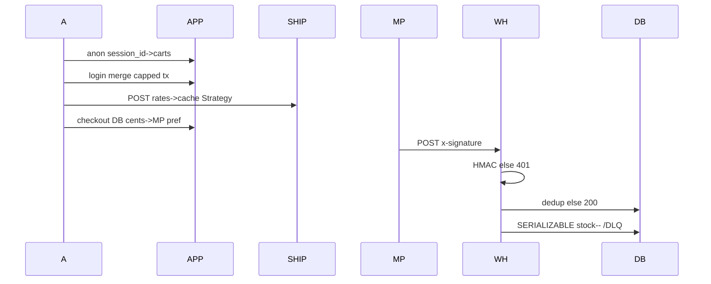

# Design: ecommerce-high-end-constitution

## Technical Approach
Codify CONSTITUTION v3.1 (154 rules) as guardrails on Next 16+Supabase baseline (12% compliant). Expand/contract DB, [locale]+next-intl first, gates (Zod/CSP/RLS/Decimal.js) block drift, slices A-D <=800l. Specs = truth.

## Architecture Decisions

| # | Rule | Choice | Rejected | Why |
|---|------|--------|----------|-----|
| AD-01 | I18N-01..03 | next-intl 4.x [locale]+routing.ts+messages/{locale}/{ns}.json x6, createMiddleware in proxy.ts | manual | Mandated; ICU, SSR (Context7) |
| AD-02 | MONEY DB-03 | price_cents INT+currency='ARS'; (cents/100).toFixed(2); Decimal.js HALF_UP/DOWN | numeric | Zero drift; expand->backfill->dual->drop |
| AD-03 | PRIV-05 WEBHOOKS-01 | MP Bricks zero-PAN; SERVER-only; POST /webhooks/mercadopago HMAC 401-only + processed_events PK + DLQ 1MB | store PAN | PCI free; constant-time |
| AD-04 | ECOM-06 LOG RES-02 | ShippingCarrier Strategy Andreani/Correo/OCA + Upstash session+CP+hash 60/300; p-limit x5+jitter; fallback fixed_shipping_cents | single | Quota-safe; 8s 3/60->30s probe |
| AD-05 | CONCURRENCIA-01 | OCC 409 catalog; SERIALIZABLE+FOR UPDATE stock | app lock | No double-sell |
| AD-06 | SEC COOKIE RLIM | CSP/HSTS63072000/DENY/nosniff; HttpOnly Secure SameSite; Upstash slidingWindow 5/15m 60/m 600/m 10/h ->429 | memory | Serverless |
| AD-07 | PERF HTTP STOR | 25/100 page, @tanstack/virtual>50, Brotli>1KB, immutable1y/private/swr300, mutex, presigned 10MB/1GB | client page | p95<2s; CSS vars |
| AD-08 | OBS HEALTH ERR | instrumentation.ts OTel+Sentry; /health+/live+/ready 2s/1s/2s 200|503; Boundary 2-level | console | Alerts >1%/5m |

## Data Flow

```mermaid
flowchart TB
U[Browser 44px]-->M[proxy: next-intl+RLIM+Supabase]
M-->APP[Next [locale]]
APP-->ACT[Actions Zod+auth+ownership]
ACT-->DB[(Postgres RLS is_admin)]
APP-->RD[(Upstash ship+RLIM+mutex)]
APP-->ST[(Storage presigned)]
DB-->CRON[pg_cron >4h/72h]-->QS[QStash]-->RE[Resend locale]
MP[MercadoPago]-->WH[/webhooks HMAC/DLQ/]
Andreani/Correo/OCA-->SHIP[/shipping/rates Strategy/]
SHIP-->RD
```


Bank: presigned bank_proofs/{order}/{uuid}->pending_verification->QStash->Resend <200ms->authorized; 72h cancel. Auth anon session_id Lax vs JWT; RBAC; Turnstile.

## Data Model (Slice B, expand/contract)

```sql
-- each: ADD nullable -> backfill ROUND(price*100) -> dual -> DROP old
ADD price_cents INT, currency CHAR(3)='ARS', sale_price_cents INT, sale_start/end timestamptz, deleted_at timestamptz;
ADD search_vector tsvector; GIN(search_vector);
ALTER cart_items ADD session_id UUID; carts(id,session_id,user_id);
-- new: audit_logs(INSERT-only JSONB), security_logs(1yr), processed_events(PK), failed_webhooks_log, entitlements, global_settings/tenants(CSS vars)
-- ENUM draft->pending->pending_verification->authorized->processing->shipped->delivered->canceled->refunded +422 fn
```

## API Contracts

| Method | Path | Auth | OK | Err |
|--------|------|------|----|-----|
| POST | /api/shipping/rates | anon | 200 {source,rates} X-Cache | 429 |
| POST | /api/webhooks/mercadopago | HMAC 1MB | 200 (401 only) dedup 200 | 401 |
| GET | /api/health | public | 200 {ok,checks} 2s/1s/2s | 503 |
| GET | /api/health/live /ready | public | 200 | 503 |
| POST | /api/bank-proof/url | user | 200 {url,path} | 401/422 |
| GET | /api/manifest?tenant= | public | manifest | - |

Cache sha(session+CP+hash) SETEX 60 swr300. i18n routing.ts [es-AR,en,fr,pt-BR] 308 /->/es-AR/ hreflang x4 Intl UTC. Shipping Carrier{getRates,createLabel:A4|ZPL} 8s batch CP SSE >100.

## File Changes (<=150l CQ-03)

| File | Action | Purpose |
|------|--------|---------|
| src/config/env.ts | Create | Zod fail-closed |
| src/i18n/routing.ts,request.ts + messages/{locale}/{6ns}.json | Create | next-intl |
| src/proxy.ts | Modify | compose next-intl+RLIM+Supabase |
| src/app/[locale]/ | Create | locale group |
| supabase/migrations/0002..0007.sql | Create | INT/GIN/audit/DLQ/ENUM |
| src/lib/shipping/*,circuit.ts + src/app/api/* | Create | Strategy/cache + contracts |
| src/lib/{validations,actions,db,rate-limit} | Create | ARCH-05 triple |
| src/components/{ui,shared,[feature]} | Create | 44px pill 50px |
| instrumentation.ts,logger.ts + next.config.ts,database.types.ts | Create/Modify | OTel/Sentry + CSP/Brotli |

## Testing

| Layer | What | How |
|-------|------|-----|
| Unit | Decimal/HMAC/OCC 409/422 | factories |
| Integration | RLS/SERIALIZABLE/merge/DLQ | EXPLAIN |
| E2E | anon->pay, bank, HIT/fallback, axe/44px | sad paths |

Cov 90/80 A10->B30->C60->D80/90.

## Cost-Zero Audit

| Service | Free | Math 500 SKUs |
|---------|------|---------------|
| MP | 0 fixed | zero-PAN |
| Supabase 500MB/1GB | RLS/cron/Storage | ~15MB SKUs |
| Upstash 10k/d | RLIM/cache/mutex | -90% -> <2k/d |
| QStash 500/d Resend 100/d | async | 6/d+100/d fits |
| Vercel 100GB | Brotli swr300 | -70% BW |

## Rollout

Expand/contract no revert; flags.new_checkout_active <1s kill. Trigger 5% err/2m p95>3s 503>30s -> vercel rollback+flag off. DLQ replay.

## Slices A-D (<=800l chained PR)

| Slice | PRs | Lines | Scope |
|-------|-----|-------|-------|
| A Bootstrap | PR1 | ~400 | env.ts CSP i18n [locale] tokens ->:root ui skeletons types .gitignore logger |
| B DB | PR2-3 | ~600/2 | INT/GIN/deleted_at/audit+security/processed+DLQ/entitlements/carts/ENUM |
| C Security | PR4 | ~500 | RLIM 429 Turnstile HMAC circuit presigned CORS-WH |
| D Perf/E-com | PR5-6 | ~700/2 | page 25/100+virtual merge 44px Strategy A4/ZPL SSE abandoned 4h+72h health seeds |

## Open Questions
- [ ] MP secret rotation 90d per SEC-01?
- [ ] Carrier priority when both HIT (Andreani first)?
- [ ] super_admin 2FA: TOTP vs passkey before B entitlements.
